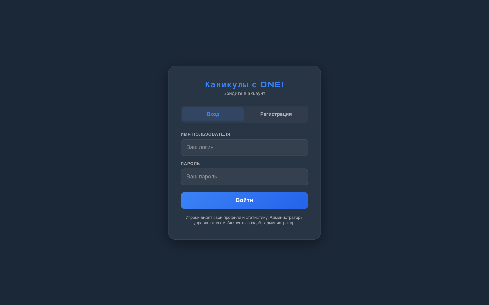
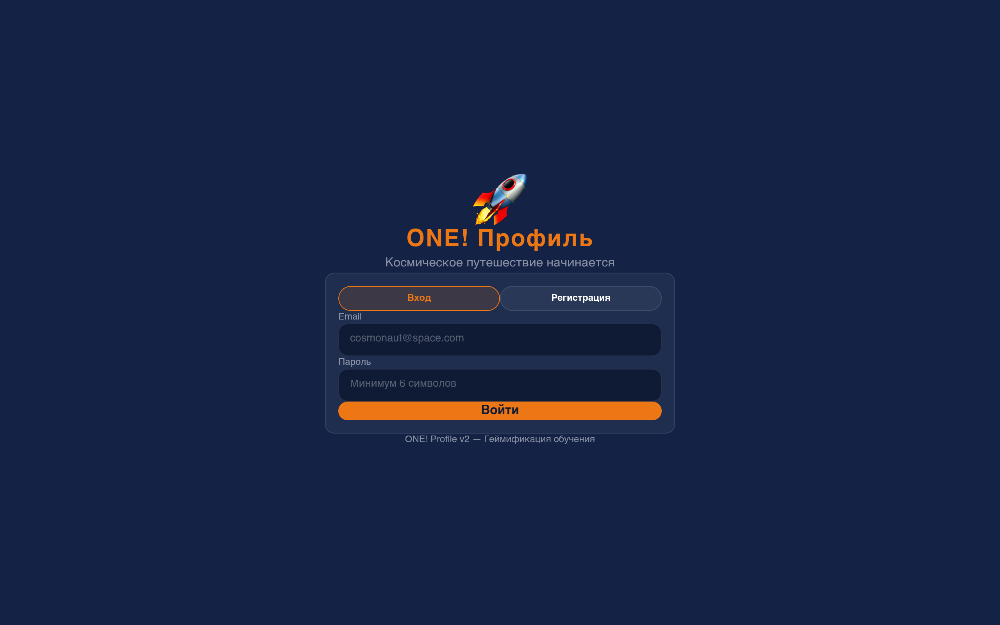
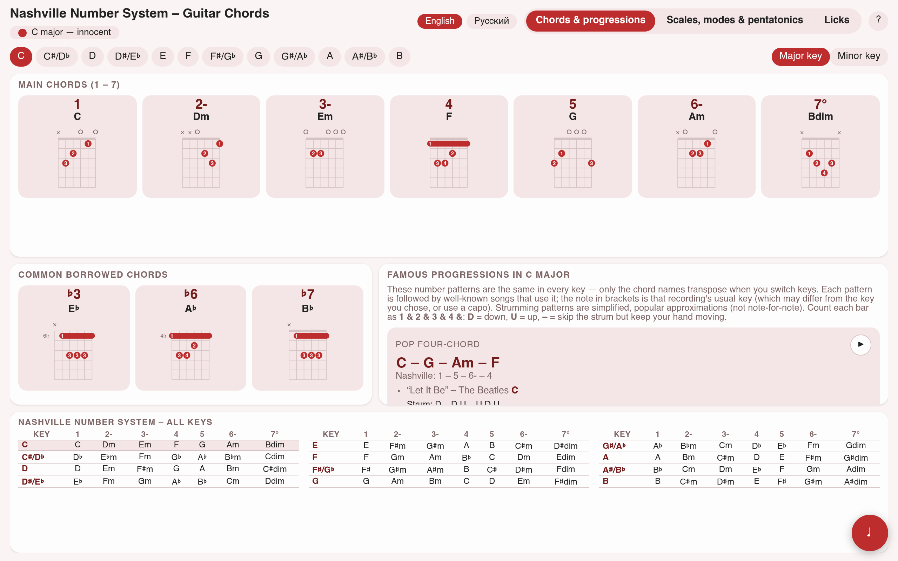
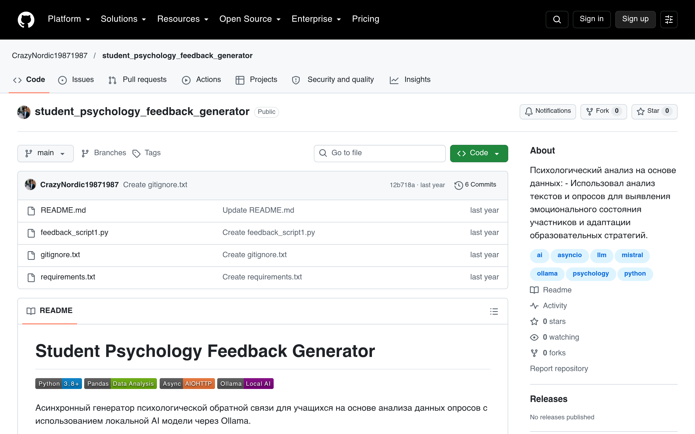
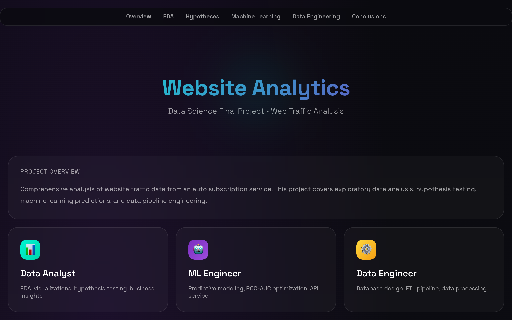

### Andrey Kuleshov · product & education technologist

I build educational products and digital prototypes — from the idea, game mechanics and metrics all the way to a deployed application. I combine a background in education (school and camp, methodology, gamification, 700+ students) with hands-on build skills: **React / TypeScript / Supabase**, **AI** (OpenAI and local LLMs) and **data** (Python, SQL, Power BI, management reporting).

**20 live prototypes** · each one opens by link · open to **part-time**

 

 

**[🇷🇺 Русский](README.md) · [🇬🇧 English](README.en.md)**

---

## ⭐ Flagship projects

<table>
<tr>
<td width="50%" valign="top">

<h3><a href="https://crazynordic19871987.github.io/kanikuly-s-one/">Kanikuly with ONE!</a></h3>
Full-cycle camp platform: 11 themed shifts, in-game economy (XP, NEO-coins, 90 cards), DISC profiles, missions and PDF reports for parents.  
React · Supabase (PostgreSQL, RLS) · GitHub Actions 
<a href="https://crazynordic19871987.github.io/kanikuly-s-one/"><b>Demo →</b></a> · <a href="https://github.com/CrazyNordic19871987/kanikuly-s-one">Code</a>
</td>
<td width="50%" valign="top">

<h3><a href="https://crazynordic19871987.github.io/one-profile-v2/">ONE! Profile v2</a></h3>
An RPG participant profile (avatars, levels, XP, progress) with an AI mentor that generates personalised feedback per student.  
React · TypeScript · Tailwind · OpenAI API 
<a href="https://crazynordic19871987.github.io/one-profile-v2/"><b>Demo →</b></a> · <a href="https://github.com/CrazyNordic19871987/one-profile-v2">Code</a>
</td>
</tr>
<tr>
<td width="50%" valign="top">

<h3><a href="https://crazynordic19871987.github.io/nashville-number-guitar/">Nashville Number Guitar</a></h3>
Offline trainer for the Nashville Number System in a single HTML file: 12 keys, 17 progressions with transposition, 49 licks, a Web Audio API metronome.  
JavaScript · Web Audio · SVG · i18n 
<a href="https://crazynordic19871987.github.io/nashville-number-guitar/"><b>Demo →</b></a> · <a href="https://github.com/CrazyNordic19871987/nashville-number-guitar">Code</a>
</td>
<td width="50%" valign="top">

<h3><a href="https://github.com/CrazyNordic19871987/student_psychology_feedback_generator/">Feedback Generator</a></h3>
Asynchronous generation of psychological feedback from student surveys on a local LLM — private, no cloud.  
Python · pandas · AIOHTTP · Ollama (Mistral) 
<a href="https://github.com/CrazyNordic19871987/student_psychology_feedback_generator"><b>Code →</b></a>
</td>
</tr>
<tr>
<td width="50%" valign="top">

<h3><a href="https://crazynordic19871987.github.io/WebAutoSubscription---DE-DA-ML/">SberAutoSubscription — Data Science</a></h3>
The full DS cycle in one project: EDA and hypothesis testing (1.86M sessions), an ML model (Random Forest) with a Flask API and a data pipeline with a database.  
Python · pandas · scikit-learn · Flask · SQLite 
<a href="https://crazynordic19871987.github.io/WebAutoSubscription---DE-DA-ML/"><b>Demo →</b></a> · <a href="https://github.com/CrazyNordic19871987/WebAutoSubscription---DE-DA-ML">Code</a>
</td>
<td width="50%" valign="top">

<b>15 more live prototypes</b> — quizzes, games, maps, shops, presentations and camp planning.  
See the links by category below. Or open the:  
<h3><a href="https://crazynordic19871987.github.io/edtech-prototypes/">📁 full 20-demo gallery →</a></h3>

</td>
</tr>
</table>

---

## 🗂️ All live demos

<b>Products & platforms</b>

- [**Kanikuly with ONE!**](https://crazynordic19871987.github.io/kanikuly-s-one/) — gamified camp platform
- [**ONE! Profile v2**](https://crazynordic19871987.github.io/one-profile-v2/) — participant profile + AI mentor
- [**ONE! Profile**](https://crazynordic19871987.github.io/one-profile/) — player profile: ranks, XP, progress

<b>EdTech prototypes & interactives</b>

- [**InnoCity**](https://crazynordic19871987.github.io/team_leader_school/) — leadership quest school (14 days)
- [**Quiz "Scout Tech"**](https://crazynordic19871987.github.io/summer_quiz1/) · [**Quiz "ONE! City"**](https://crazynordic19871987.github.io/quizz/) — quizzes
- [**2D adventure**](https://crazynordic19871987.github.io/summer_game4/) — shift game space
- [**Talents map**](https://crazynordic19871987.github.io/talents/) · [**BioCrafters economy**](https://crazynordic19871987.github.io/shop_city_camp/) — game mechanics
- [**Personal report**](https://crazynordic19871987.github.io/student_report_sample/) · [**Skills reports**](https://crazynordic19871987.github.io/skills_report1/) · [**Feedback breakdown**](https://crazynordic19871987.github.io/preza1/)

<b>Presentations, planning & content</b>

- [**Management Academy**](https://crazynordic19871987.github.io/management_presentation/) · [**Marketing plan**](https://crazynordic19871987.github.io/marketing_plan/)
- [**Club landing**](https://crazynordic19871987.github.io/official.kruzhok.io/) · [**For parents**](https://crazynordic19871987.github.io/parents/)
- [**Season calendar**](https://crazynordic19871987.github.io/calendar/) · [**Gantt chart**](https://crazynordic19871987.github.io/gant/)

<b>Music education</b>

- [**Nashville Number Guitar**](https://crazynordic19871987.github.io/nashville-number-guitar/) — Nashville Number System guitar trainer

<b>Data, AI & automation (Python / Jupyter)</b>

**Data:** [SberAutoSubscription (DA+ML+DE)](https://github.com/CrazyNordic19871987/WebAutoSubscription---DE-DA-ML) · [Cohort analysis](https://github.com/CrazyNordic19871987/cohort_user_analysis) · [Hypothesis testing](https://github.com/CrazyNordic19871987/Statistical_Hypothesis_Testing) · [Price ML pipeline](https://github.com/CrazyNordic19871987/price_classification_pipeline)

**AI & bots:** [Feedback Generator](https://github.com/CrazyNordic19871987/student_psychology_feedback_generator) · [History Telegram bot](https://github.com/CrazyNordic19871987/tg_bot_history_assistant) · [Lesson helper](https://github.com/CrazyNordic19871987/school_helper) · [Meme generator](https://github.com/CrazyNordic19871987/meme_generator.py) · [Ollama function calling](https://github.com/CrazyNordic19871987/project_with_feedback.py)

---

## 🧰 Stack

 

---

### 📬 Contact

Open to part-time projects: prototypes, EdTech products, dashboards and reporting.

Some projects were built in dialogue with AI agents (vibe coding)

